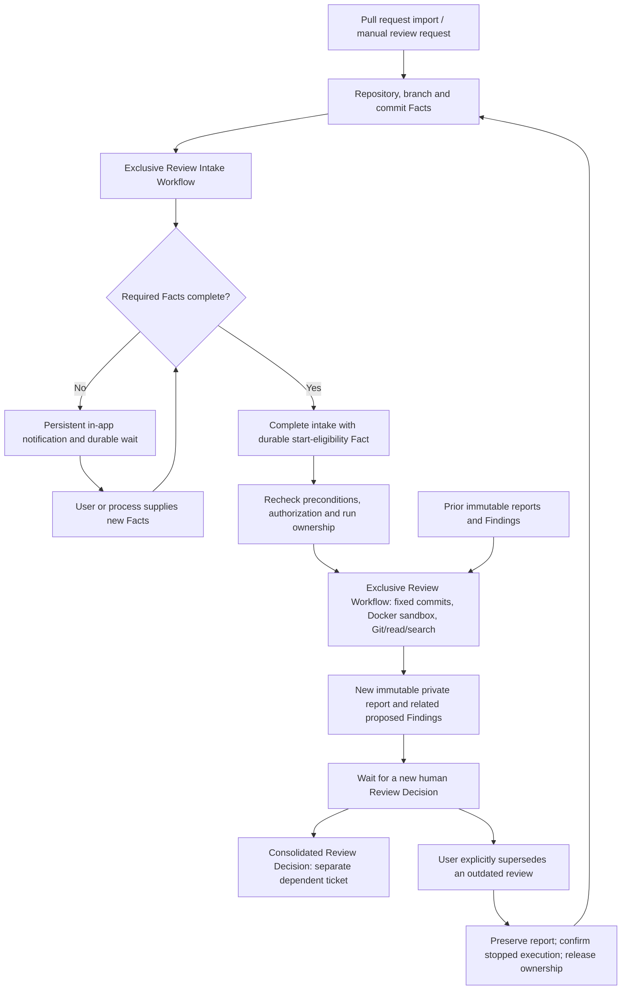

# Durable private Review Workflow

Status: accepted implementation baseline; User confirmed on 2026-10-05 at the human checkpoint in
[Issue 05](../issues/05-durable-private-review-report.md).

Provider/model selection: OpenRouter with OpenAI GPT-6 Luna, selected by the User
on 2026-10-04. The current checkpoint decisions below supersede incompatible parts
of the earlier draft. The User confirmed the consolidated design on 2026-10-05.

This design preserves the accepted foundations, canonical glossary, and ADRs
0003–0005, 0007–0010. The human checkpoint is complete. The design authorizes its
dependent implementation without claiming executed runtime evidence; technical
choices still require the verification described below.

## Current checkpoint decisions

The comments in [Generate a private report in a durable Review Workflow](../issues/05-durable-private-review-report.md#comments)
are the primary record of the User's answers. This section identifies their effect
on the draft and the next decision frontier.

### Agreed direction

- Repository exploration replaces required supplied patches. The Workflow obtains
  a checkout in a sandbox and gives agents Git and exploration tools. Agents can
  inspect branch differences and relevant unchanged files. MVP tools are Git,
  file reading, and search only; tests and repository commands are not agent tools.
  Subordinate agents are declared in platform source code and share the Workflow
  Run's limits. A full diff is not a mandatory prompt input.
  The MVP uses an installation-operated Docker sandbox per run, recreable from
  retained commits. This replaces the LocalSandbox/Bubblewrap proposal without
  imposing a Linux-only worker deployment. Additional Mastra-supported sandbox options follow successful
  local MVP validation; they are not prerequisites for that validation.
  Repository Access Credentials are encrypted Organization-owned records selected
  per Repository and reusable across Repositories within the same provider/access
  scope. Agents never receive checkout credentials.
- Pull request import records source and target branches as Facts. Missing data
  must be reported to the User by field name, retaining the incomplete Work Item.
  Review fixes source and target commits and compares source changes since their
  common ancestor; later branch movements do not mutate that checkout.
- Pull request import initiates a separate Review Intake Workflow. It waits for
  required review fields represented by concrete Facts, notifies missing fields,
  and emits a review-start eligibility Fact only when its preconditions are met.
  Users and other processes can supply those Facts. Eligibility is distinct from
  Activity Approval and current execution authorization.
  Intake retains the Work Item's exclusive Workflow Run ownership while waiting.
  It completes with a durable handoff before Review Workflow takes ownership.
  Missing-field notifications are persistent in-app records in the Work Item and
  Kanban Board; email delivery is not required for the MVP.
  Manual review requests use the same intake and prerequisites when Users or other
  processes supply the required Repository, branch, and commit Facts.
- AI resources may be provided by the platform under an Organization subscription
  or provided by the Organization. The selected initial OpenRouter/GPT-6 Luna route
  remains. Organization-provided AI uses the Organization's provider API key and
  configuration, including URL, model, and reasoning effort. This is not an
  external interactive assistant subscription. Mastra determines provider
  integration constraints; the supported configuration contract must follow
  verified Mastra capabilities rather than an OpenAI-compatible-only assumption.
  Platform AI entitlement is activated or revoked operationally per Organization,
  recording consumption without implementing contracting or billing in the MVP.
- An agent-call time budget and a separate execution time budget replace the draft's
  single generation deadline. AI time sums model-call durations across parent and
  subordinate agents and excludes tools: three simultaneous ten-second calls
  consume thirty seconds. Execution time measures elapsed active execution,
  including checkout, tools, and coordination, excluding human and timer waits:
  those same concurrent calls consume ten execution seconds. Both budgets must
  survive recovery.
  Configurable defaults are 40 model calls, 600 cumulative AI seconds, 1,200 active
  execution seconds, and four simultaneous subordinate agents per Workflow Run.
  Stricter installation limits bound effective Organization limits.
- Provider, model, reasoning effort, and nonsecret configuration are retained at
  run start; configuration changes apply to new runs. Rotation of the same
  credential may be used for subsequent calls. Permission, credential, or platform
  AI entitlement revocation prevents new dispatch; providers never switch implicitly.
- Exhausted limits or unknown AI outcomes stop execution visibly, preserving
  Facts, completed results, and consumption. Incomplete reports are not complete
  reports; uncertain calls remain counted without automatic replay. Release run
  ownership only after execution is confirmed stopped.
- One worker, concurrency across distinct Work Items, and manual crash recovery are
  accepted as the initial operating model. Completed outputs and suspended review
  must survive recovery without repeating completed Activities.
- A private summary and proposed Findings, with severity, explanation, and optional
  location, are displayed in the Kanban Board and downloadable as Markdown. Empty
  reports still require a Review Decision; generation does not change Factory state.
- New Facts trigger evaluation of platform and Organization preconditions. The
  evaluation may produce derived Facts, some initiating Workflows. Initial rules
  are deterministic and provided by the platform, with parameters configurable
  by Organization. Nondeterministic evaluation is a future direction. A derived
  start Fact enters the authorized Transition Request path under Service Identity.
  The initial catalog supports pull requests opened/updated, Organization and
  Repository scope, target branches, and draft conditions. Rules are disabled
  until enabled by the Organization; required data, Git/AI access, and Service
  Identity authorization are prerequisites, and derived Facts retain their cause.
- Commit updates remain Facts. A subsequent review receives prior review results
  so its agent can relate Findings and propose enrichment, obsolescence, or
  resolution. Prior reports and human decisions remain immutable; automatic
  human confirmation for a changed report is not authorized.
  Each new report contains its own related Findings and requires a new Review
  Decision. During a human wait the User explicitly supersedes an outdated review,
  preserving its report and closing its run without publication before the next
  run starts; there is no automatic replacement or premature ownership release.

### Remaining User decision frontier

The product decision frontier is empty after the Docker selection. Provider,
local-sandbox, and Docker integration research are resolved. The User confirmed
the consolidated design on 2026-10-05, completing the human checkpoint. Declared
adapter compatibility is not executed runtime proof.

### Implementation and feasibility follow-ups

- Intake and handoff: specify durable causal handoff and notification schema
  against the agreed exclusive-intake/in-app-notification contracts.
- Repository retrieval: specify fork access and missing-commit handling against
  the agreed per-Repository binding and reusable credential model.
- Sandbox: establish the Docker Mastra integration and implement isolation,
  Git operation bounds, outbound access, and resource limits. Other supported
  backends are later work after the local MVP is validated.
- AI resources: establish Mastra-supported protocols, entitlement and consumption
  attribution for platform AI, endpoint validation, and configuration changes
  affecting active runs, without implicit provider fallback.
- Budgets: implement enforcement during concurrent calls and crashes, reservations,
  and the agreed numeric defaults and subordinate-agent concurrency limit.
- Automatic evaluation: settle parameter bounds, versioned inputs, and exact causal
  deduplication/loop prevention, including intake behavior during an existing run.
- Successive reviews: specify Finding relationship representation, explicit User
  supersession, and updates during generation against the agreed immutable
  reports, renewed human review, and confirmed-stop ownership contracts.

The accepted platform-owned Workflow boundary and fixed human Finding confirmation
remain in force. Configurable automatic-start preconditions are distinct from
configurable Approval Point confirmation rules; customer executable Workflows are
not authorized by this direction. Any later conflict with ADRs 0007 or 0009 must
be resolved explicitly.

## Agreed review flow

The graph records the agreed ownership and report relationships, not approval
of the remaining technical implementation details. New commit Facts are admissible
during execution and human waits; they do not mutate the fixed checkout or start
an overlapping run. A generated report leaves Factory state unchanged.

### Superseded draft assumptions

The original required `reviewPatch`, fixed provider URL/model configuration,
Organization-owned-key-only AI mode, single generation deadline,
single-response-only review, and operator-only automatic start are superseded.
Their incompatible details have been removed from the implementation draft;
the initial proposal remains available in Git history and earlier issue comments.
The revised implementation design below is the accepted baseline. Technical
options explicitly described as proposals remain engineering choices to validate;
they do not reopen the agreed product behavior or waive runtime verification.
Findings may refer to relevant unchanged code,
so validation cannot be restricted to changed diff lines. The earlier verification
plan must be expanded to cover sandbox isolation, checked-out revision provenance,
subordinate agents, both AI resource modes, separate budgets, and Fact-driven starts.

## Implementation design

The following details form the implementation baseline accepted by the User.
Technical options explicitly described as proposals guide implementation and
must be validated. Material departures from the agreed behavior require explicit
reconsideration; none restores the superseded supplied-patch or provider restrictions.

### Workflow definitions and intake

Install platform-owned, versioned Review Intake Workflow and Review Workflow
definitions in the separate Mastra worker. Preserve retained Work Item Type
definitions, extending them explicitly rather than reinterpreting existing items.
A Review Intake Workflow starts from pull request import or a manual review request, waits durably for required
Facts, and produces a causal start-eligibility Fact once configured preconditions
are satisfied. Intake retains exclusive ownership while waiting. Notification
records are persistent in-app records; no email integration is required. Durable
handoff completes intake before accepting the Review Workflow, preserving causal
provenance and recoverability without overlapping runs.

Represent source and target branches, Repository/provider identity, and resolved
source/target commits as Facts or references to immutable Facts. Do not infer a
missing branch silently. The User can see which fields are missing and the intake
can resume when authorized Users or other processes supply them. The Review
Workflow's own prerequisites still require these Facts; intake output is not an
authorization bypass.

Deterministic platform rules have versioned Organization parameters for Repository
scope, target branches, and draft eligibility. Opened/updated pull requests are
initial rule inputs; automatic rules are disabled until enabled. Persist evaluation
causes and the bound Fact/configuration versions. Deduplicate derived eligibility
and start effects independently from webhook delivery deduplication. Exact causal
keys, evaluation ordering, and cascade bounds still need specification.

A durable handoff must recover after a crash between intake completion and review
acceptance. Recheck current prerequisite Facts and authorization before accepting
a run. An already active or suspended run cannot be overlapped. Changes received
during review remain Facts available for subsequent review.

### Repository checkout and sandbox tools

The platform resolves and verifies immutable source and target commits before
review; the baseline is their common ancestor. Persist the actual checkout and
comparison provenance in the report's relevant-input binding. Source/target branch
names alone are insufficient revision identity, particularly for fork pull requests.

Repository retrieval uses separate outbound read credentials. Existing GitHub HMAC
and Azure DevOps Basic webhook credentials provide inbound event authentication,
not checkout access. Each Repository references an encrypted Organization-owned
Repository Access Credential, which other Repositories may share within the same
provider/access scope. Agents do not receive this credential. Fork retrieval and
provider URL validation require concrete implementation contracts; manual review
uses the same required Facts and verified checkout provenance.

The sandbox exposes bounded Git exploration, file reading, and search. Only
platform source code declares the parent/subordinate agents and their tool
capabilities; repository files do not define executable tools. Agent tools do not
execute repository tests, install dependencies, modify source, push, or merge.
Platform-controlled retrieval may prepare the checkout, without exposing those
preparation privileges as unrestricted agent commands.

Use a Docker sandbox for the MVP, one isolated checkout per run, recreating from
retained commits after restart. Establish the Mastra-supported local mechanism,
path/symlink boundary, Git operation allowlist, outbound-access policy, and
CPU/memory/disk limits before implementing it. Keep checkout content out of the mandatory main prompt.
Use bounded tool output and subordinate-agent summaries; preserve report provenance
even if disposable checkout storage is removed after completed analysis.

The [local sandbox research](../research/mastra-local-sandbox-contracts.md) verifies
Workspace, LocalFilesystem, and LocalSandbox against the selected pin. Compose
one Workspace per run and expose only selected read/search tools and constrained
platform Git actions, disabling generated arbitrary-command tools. LocalSandbox
defaults to host execution without isolation; opt-in Bubblewrap applies on Linux
and Seatbelt on macOS. The working directory and filesystem containment do not
isolate shell execution. The Linux/Bubblewrap proposal is superseded by Docker.
The [Docker integration research](../issues/15-mastra-docker-sandbox-contract.md)
owns adapter/version and filesystem/lifecycle feasibility; LocalSandbox evidence
does not establish Docker compatibility. Validate later
WorkspaceSandbox adapters individually after the local MVP is demonstrated.

The [resolved Docker evidence](../research/mastra-docker-sandbox-contracts.md) checks
`@mastra/docker` 0.9.2 at the source commit matching core 1.74.0 and confirms a
declared compatible peer range. The adapter supports container lifecycle and
explicit Docker mounts/file upload, not the generic Workspace filesystem mount.
Production import/runtime compatibility, image tools, isolation, and recovery
must be verified during implementation before claiming an operational sandbox.

#### Docker integration policy

Use one platform-owned Docker sandbox and checkout per Workflow Run. Mastra agents
and model dispatch remain in the worker; their repository tools operate through
the container's restricted execution/filesystem boundary. Docker orchestration is
trusted worker code, not an agent capability. Do not pass the Docker daemon socket,
provider keys, or Repository Access Credentials into the agent's environment.

The container image must include Git and the supported read/search utilities;
pin its identity rather than relying on a mutable default image. Explicitly define
how the checked-out files become accessible to both filesystem/search and Git
tools. A host LocalFilesystem path is not assumed to exist inside a container.
The selected implementation proposal prepares the checkout inside the container
through controlled code and routes platform-authored Git/read/search tools through
DockerSandbox. It does not rely on implicit host-filesystem mounts. Expose only
bounded tool results; repository instructions cannot enable execution tools.

Record container/run identity, image and checkout provenance, and resource policy
for recovery. Reconnect only to the expected run's container or recreate its
checkout from retained commits. Confirm container/tool execution stopped before
ownership release; Docker unavailability is not proof of stopped execution.
Retain authoritative results and Artifacts outside disposable checkout storage.

Require the configured Docker isolation and never fall back to unisolated host
commands. Concrete image, filesystem/mount strategy, CPU/memory/disk/network
settings, and lifecycle verification follow the checked adapter capabilities.

### AI resources and authorization

An Organization selects platform AI or its own provider configuration. Its own
configuration includes provider URL, API key, model, reasoning effort, and supported
settings. Mastra integration capabilities define supported provider/adapter contracts.
The prerequisite [Establish Mastra AI provider configuration constraints](../issues/13-mastra-ai-provider-contracts.md)
owns source-backed findings and selected-version limitations.

The [resolved research](../research/mastra-ai-provider-contracts.md) verifies router
IDs, native AI SDK model instances, and explicit OpenAI-compatible configurations
against the 1.74.0 pin. Custom URL support is adapter-specific; reasoning effort is
provider/model-specific. Resolve Organization credentials explicitly, without
process-wide environment mutation or implicit environment-key fallback. Validate
tool/report capabilities for the selected adapter and model. A separate
report-structuring model call, if necessary, consumes the same shared run budgets.
Framework timeouts do not supply cumulative cross-agent AI accounting; Factory
must meter individual calls and persist both budget ledgers.

OpenRouter with GPT-6 Luna remains the selected initial platform route. The earlier
catalog observation is historical evidence from the provider/model checkpoint,
not a substitute for checking the chosen runtime adapter and current capabilities.
Do not require OpenRouter catalog/routing fields from unrelated providers, discard
unsupported effort parameters silently, or switch resource modes implicitly.

Proposed configuration operations remain Organization-scoped under `ai.manage`,
with Membership, policy, and API Credential bounds. Store own-provider keys through
OrganizationSecrets and the recoverable key ring; expose nonsecret configuration
and key-present status only. Platform subscription entitlement and key custody
must be explicit and never expose a platform key to an Organization or repository
tools. A shared platform route does not merge Organization data, authorization,
or consumption records.

Installation operators activate/revoke platform AI entitlement per Organization
and consumption remains attributable to the Organization/run. No contracting,
payment collection, or billing UI is included in this MVP increment.

Bind nonsecret configuration/version provenance to each run. Recheck current
permission, resource availability, and subscription entitlement before dispatch.
Retain provider, model, effort, and nonsecret configuration for an existing run;
configuration changes apply to new runs. Rotation of its referenced credential may
be used by subsequent calls. Permission, credential, or entitlement revocation
prevents further dispatch; never switch providers implicitly. Provider/account billing and platform
subscription charging are distinct from observed model usage.

Manual starts retain the requesting User as Execution Identity, including applicable
API Credential bounds. Automatic starts use the Organization's Service Identity
and all its applicable Team policies. Review-start eligibility does not grant
execution permission or replace an Activity-bound Approval. Preserve default deny,
explicit-deny precedence, and current authorization rechecks.

Proposed Activities include `transition.request-review`, `review.generate`,
`workflow.read`, and `artifact.read`, with distinct human Approval for generation
when policies require it. The exact intake and repository-read Activities remain
to be named and agreed. Browser session expiry alone does not cancel a durable run;
Membership and applicable credential revocation still govern execution.

### Budget and consumption enforcement

The agreed budgets are cumulative model-call time and elapsed active execution
time, shared by parent and subordinate agents. AI time excludes tools; execution
time includes checkout, tools, and coordination and excludes human/timer waits.
Do not use one generation deadline to represent both ledgers.

Proposed model-call counting reserves each dispatch durably before network I/O.
Reservations include parent and subordinate calls and consume the shared count,
including failures and uncertain outcomes. Conservative counting can exceed
observable HTTP requests; it is not a claim about hidden upstream retries.
Use the agreed defaults: 40 calls, 600 summed AI seconds, 1,200 active execution
seconds, and four simultaneous subordinate agents. Organization configuration may
adjust them within stricter installation bounds. Concurrency reservation,
crash-time accounting, and queue accounting require an implementation contract.

Persist progress and enforce limits before starting work and during concurrent
calls. Budget expiry cannot by itself release exclusive ownership. Disable hidden
retry/fallback paths; any supported retry must reserve another counted call within
both time budgets. The earlier retry recommendation allowed explicit HTTP 429/5xx
responses and refused automatic replay after lost connections, timeouts, or unknown
outcomes; finalize this against the chosen Mastra/provider runtime.

On exhausted limits or unknown AI results, stop visibly and retain Facts, completed
outputs, and consumption. An uncertain call stays counted and is not automatically
replayed. Do not mark a partial report complete. Ownership remains until the
worker or authorized recovery path confirms no execution continues.

Retain attempt identity, parent/subordinate relationship, model and provider
provenance, start/end times, outcome, and returned tokens/cost when available.
Missing usage or cost is unknown rather than zero. Aggregate known usage separately
from unknown attempts. An abort does not prove remote processing or charging stopped.

### Exclusive ownership and recovery

The accepted initial operating model is one worker, bounded concurrency across
different Work Items, and manual crash recovery. The earlier proposed default
concurrency of four is still a tunable proposal, not an agreed product requirement.

Proposed transactional acceptance installs run ownership, causal/request receipts,
and history together without changing Factory state. Per-run ownership tokens
guard authoritative writes and Artifact attachment. Direct transitions check
the active-run association; new authorized Facts remain admissible.

A proposed worker-volume startup lock rejects a second worker and requires an
operator to verify the prior process stopped before recovering after a crash.
There is no automatic lease-expiry takeover. Neither a missed heartbeat nor a
budget deadline proves stopped execution. Only confirmed stop permits release
and a subsequent run.

Retain SurrealDB for Factory data, selected LibSQL for Mastra snapshots, and private
persistent file storage for Artifacts. Earlier pins `@mastra/core` 1.74.0 and
`@mastra/libsql` 1.25.0 require compatibility checks for the expanded agent/tool
runtime before production adoption.

Persist completed model outputs in authoritative storage before returning a
completed step. Replay consults those outputs and does not repeat completed model
calls. Reserved calls without an outcome are uncertain and require recovery.
Retain run and Workflow versions; unknown retained definitions hold ownership
with visible recovery-required status rather than using newer code silently.

Reconcile run snapshots, completed outputs, checkout provenance, report metadata,
and file digests after restart. Preserve the same suspended run and human-review
wait. Intake-to-review handoff and successive-review behavior must receive the same
crash/concurrency treatment. User cancellation remains governed by its separate
implementation ticket and confirmed-stop invariant.

### Reports, successive Findings, and private Artifacts

Structured reports contain a summary and proposed Findings with severity,
explanation, and optional location. Earlier schema limits (10,000-character summary,
100 Findings, 300-character titles, and 10,000-character explanations) remain
proposals. Locations may refer to relevant unchanged files; validate them against
the bound checkout rather than only changed diff lines.

Persist immutable report/version, relevant-input provenance, Findings, and Artifact
metadata. The Factory assigns trusted identifiers; model output cannot assign
authorization, human confirmation, or publication status. One run may make many
model/tool calls while producing one final report.

Later reviews receive earlier results and relevant human decisions as versioned
evidence. The next agent can propose that an earlier Finding is enriched, obsolete,
or resolved. Exact cross-report identifiers and status representation remain
implementation details. Historical reports and decisions are preserved; an agent's
assessment does not silently transfer or override human confirmation. The User
explicitly supersedes an outdated review during a human wait, retaining its report
and closing the old run without publication. Verify that no execution continues
before releasing ownership. The replacement rechecks prerequisites and
authorization and does not inherit the old Review Decision. The exact protected
operation and related Fact schema remain proposed.

Write deterministic private Markdown to a persistent file before attaching metadata;
retain digest, size, media type, run/report linkage, and opaque storage key.
Never attach metadata for incomplete content. Interrupted deterministic writes
can be verified/reused during recovery. Backup includes Factory data, snapshots,
Artifact content, and the encryption key ring.

Proposed protected routes expose run/report metadata and private Artifact download
under current same-Organization Membership, Work Item visibility, applicable read
Activities, and API Credential bounds. Do not expose filesystem paths or keys,
serve the Artifact volume statically, or add sharing tokens in this ticket.
The limited-sharing ticket owns external references. Fail visibly on missing or
corrupt content.

The Kanban Board displays missing intake fields, execution state, pending Approval
or Review Decision, source freshness, report versions, previous-review relationships,
and private download. Rendering is safe text; generated output does not imply
publication or Work Item lifecycle completion.

### Verification and delivery

Use the already-agreed public Factory HTTP verification seam with real persistent
SurrealDB, a separate worker, LibSQL/Artifact volumes, controllable provider evidence,
and a minimal real-browser scenario. Extend it with controllable Git repositories
and observable sandbox operations, keeping test doubles unavailable in production.

Cover import with missing branch Facts, notification and resumption from new Facts,
durable causal handoff, concurrent duplicate imports/starts, scope isolation,
current authorization, and Activity Approval. Verify sandbox tool restrictions,
exact checkout/comparison provenance, relevant unchanged-file exploration, and
platform-declared subordinate agents sharing budgets.

Cover both AI resource modes, supported provider configuration, model/effort/tool
capability failures, known/unknown consumption, concurrent model calls, separate
time budgets, interrupted calls, and confirmed-stop ownership. Test commit updates
during generation/human waits, preserved previous results, Finding relationships,
and renewed human review once their contracts are settled.

Restart web, worker, and persistent stores around missing-input and human-review
waits, completed model calls, file/metadata writes, and intake handoff. Assert no
replay of completed or uncertain external work and no overlapping ownership.
Verify authenticated provider observations remain admissible throughout.

Before delivery run typecheck, relevant tests, full suite, production build,
public-flow acceptance, formatting, and Standards/Spec code review. Keep the
implementation issue open until these requirements are implemented and verified;
a completed design alone does not unblock its implementation dependents.
