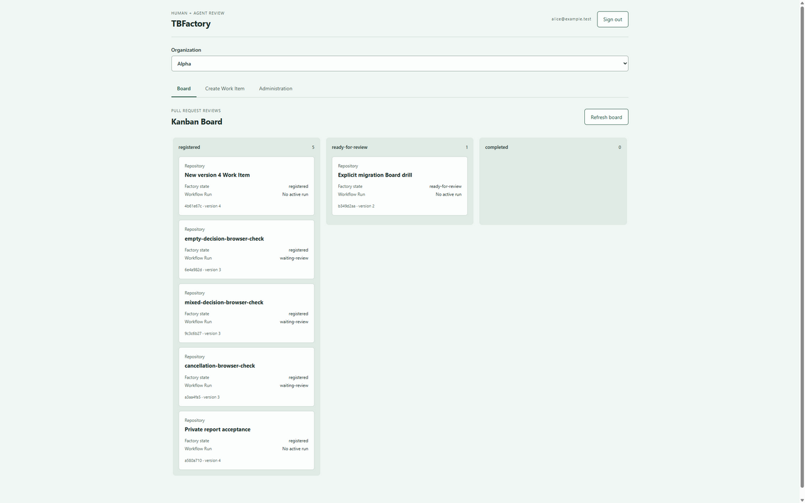

# Compact Board and first Review preparation evidence

Date: 2026-10-08. Branch: `feat/mvp-first-review-experience`, working tree based
on `e32d448`. This records local implementation evidence, not a deployed Docker
revision or real-provider acceptance.

## Delivered behavior

The home Board contains compact summary cards. Reports, Review Decisions,
transitions, Approval, cancellation, migration, publication and finalization are
in a Work Item detail URL. Creation and Administration have separate views.
Existing `/?organization=...&workItem=...` URLs resolve to detail. Native links
support reload and browser history; the Board link preserves Organization context.
Refreshing detail also refreshes its heading and immutable Fact history.

The [first Azure DevOps Review tutorial](../../../docs/operations/first-azure-devops-review.md)
records the selected initial Repository, tenant, model/effort and proposed limits.
OpenRouter configuration now accepts `max` only when declared by the selected
permitted model. Existing adapter, upstream, ownership and credential validation
remain in place. No dependencies were added.

## Automated verification

- Two focused card/navigation tests pass. Cards escape titles, omit embedded
  private report content and forms, and link to detail. Previous URLs remain valid;
  malformed search values do not become trusted resource identifiers.
- The OpenRouter `max` test first failed against the original configuration schema,
  then passed after extending its two enums. A real local worker request forwards
  `reasoning: { effort: "max" }`, requires the selected upstream without fallback,
  and retains fixture-reported cost. This is not an actual OpenRouter call.
- `npm run typecheck` and `npm run build` pass after the final code changes.
- `npm test`: 199 tests, 198 passed, zero failures/cancellations, one expected
  Windows Unix-socket skip. The ignored receipt is `.runtime/mvp-experience-tests.log`.
- `npm run format` and `npm run format:check` pass for code and repository Markdown.
  The final local document check verified 29 links/anchors; `git diff --check` passes.

The original built `tests/review-acceptance.ts --hold` run passed production HTTP,
intake resumption, actual worker/web/database restarts, retained definitions,
authenticated private Artifact access, decision validation and persistence,
same-run completion, and explicit migration preserving the report while
invalidating the old decision. Its ignored runtime directory is
`.runtime/review-48f35fd8-0937-4126-8d63-f292e97e5a8a`.

Subsequent browser fixtures used independent loopback databases and the current
production build. Their temporary harness omitted database restart to avoid
interfering with the concurrent full suite; its copied restart checklist is not
additional restart evidence. Only the executed browser actions below are claimed.

## Browser verification

The T3 collaborative preview exercised the authenticated local fixture User.
Its credentials and generated root keys are test-only and absent from this report.

- Board cards measured 162.75–183 CSS px high, including a long title submitted
  through the creation form. The Board contains no creation, report or Review forms.
- Creation redirects to the new Work Item detail. Card links, detail reload,
  Administration and return to the same Organization Board work.
- A complete human Review Decision submitted from detail was persisted and its
  waiting Workflow Run completed. The private report remained available.
- An empty report required explicit human acknowledgement and completed after
  its Review Decision. A cancellation requested in detail reached confirmed stop
  with `status: cancelled`, preserving the report and completed intake run.
- Explicit migration from version 1 to 2 followed by `prepare-review` updated
  detail, heading and history to `ready-for-review`; the Board shows the changed
  column and retained version. No real provider effect was performed.
- Administration shows Type selection, Teams, policies, Invitations and API
  Credentials without Board cards. Creation has its own form view.
- Loading messages were observed. Empty columns display zero counts. A missing
  Work Item displays `Resource not found` without detail/report panels. An
  unavailable Organization URL displays no workspace and only accessible choices.
- Native Tab navigation reaches the skip link and controls. Focus outlines are
  defined for focused controls, and the skip target accepts focus. The background
  preview has `document.hasFocus() === false`; painted keyboard focus still needs
  a foreground/manual visual check. No complete accessibility audit is claimed.
- The desktop Board was inspected at the preview's actual 2212 × 1382 CSS viewport.
  Native same-origin frames at 1366 × 768 and 390 × 844 tested actual responsive
  layout because preview resize timed out. At 390 px, the document/body width was
  375 px with the vertical scrollbar; the Kanban was 343 px wide with 808 px of
  internal horizontal content. Cards remained 162.75–183 px high.

## Remaining acceptance

The existing Docker evaluation remains at its previously accepted revision.
No real Microsoft login, Azure DevOps observation/checkout, OpenRouter call,
publication or finalization has been executed. The User will create the AI key
locally; the USD 5 total budget is proposed, not configured or accepted. Issue 20
and overall MVP acceptance remain open. The PR is chosen during the guided run.
Issue 19 remains open only for foreground focus and User visual acceptance. The
loopback browser fixture remains available at `http://localhost:3000`; its isolated
database is `tbfactory-ui-browser-db` on port 18001. The full-suite database
`tbfactory-ui-acceptance-db` was stopped after verification. The original evaluation
database/container configuration was preserved.
