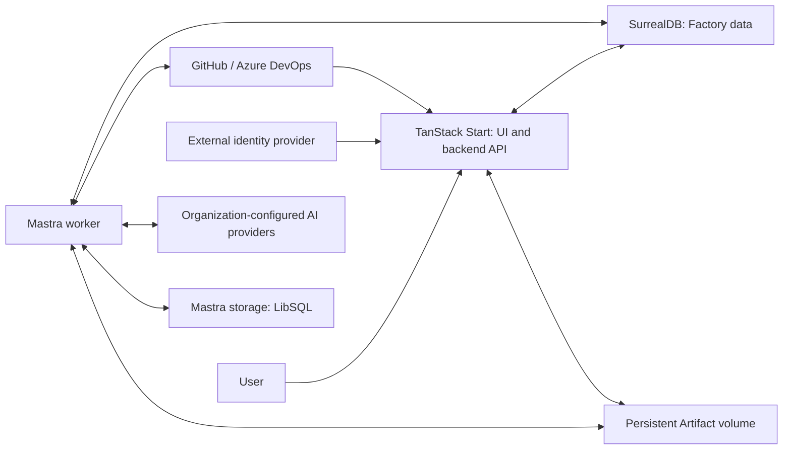

# TBFactory foundations

Accepted foundation agreed through Q46 on 2026-10-02. This document fixes the architecture, domain invariants, and MVP scope; detailed implementation specifications and runtime validation are separate follow-up work.

The canonical domain language is in [CONTEXT.md](../CONTEXT.md). Repository documentation and conversation language rules are in [AGENTS.md](../AGENTS.md).

## Purpose and MVP scope

TBFactory is an extensible platform for automating complex processes through collaboration between agents and humans. Its central concept is a Work Item: a collection of immutable Facts accumulated over time about a specific task, with its own identity and an explicitly stored Factory state.

The first functional process covers pull request review, human validation of Findings, publication, and Work Item finalization for GitHub and Azure DevOps. Modifying code, approving provider pull requests, and merging are outside the pilot. Tasks, features, and other matters fit the general domain model; their specific processes require later designs.

Initial Workflows and Work Item Types are platform code. Organizations select and configure available definitions; customer-authored Workflows and configurable Approval Point rules are post-MVP objectives.

## Architecture

| Component | Accepted responsibility |
| --- | --- |
| TanStack Start | Frontend, protected application operations, and public backend API. |
| Separate Mastra worker | Workflow and agent execution, using the same platform codebase and domain rules as the web application. |
| SurrealDB | Primary database for Work Items, Facts, current Factory state, Users, Memberships, permissions, and Artifact metadata. |
| Mastra storage | LibSQL selected by the [bounded storage-feasibility investigation](../.scratch/factory-mvp/issues/01-validate-durable-workflow-storage.md). |
| Persistent file volume | Initial Artifact content storage, accessed under Factory authorization. |
| External identity provider | Human authentication; the Factory retains ownership of Users, Memberships, and authorization. |
| Organization AI configuration | Isolated provider credentials, permitted models, and time and call-count limits per Workflow Run. |

The initial deployment is one shared multi-Organization installation on a server or in containers. The separate worker adds a process while separating long-running execution from the HTTP request lifecycle. Exact scheduling, coordination, runtime versions, authentication protocol, and deployment settings belong to follow-up specifications.

### Review Workflow checkpoint continuation

The User clarified the Review Workflow direction on 2026-10-04 in
[Generate a private report in a durable Review Workflow](../.scratch/factory-mvp/issues/05-durable-private-review-report.md#2026-10-04--human-checkpoint-continuation-repository-exploration-and-fact-driven-starts).
That checkpoint owns the detailed decisions and unresolved contracts:

- Review agents explore a repository checkout in a sandbox with Git, including
  relevant unchanged files. MVP agents use Git, reading, and search only, and may
  delegate to subordinate agents declared in platform source code. A supplied diff
  is not required. Import records source/target branches as Facts and reports missing
  fields by name. Review binds immutable source/target commits and compares changes
  from their common ancestor; sandbox/retrieval contracts remain open.
- Prove the MVP with an installation-operated Docker sandbox and an isolated,
  recreable checkout per run. Additional Mastra-supported sandbox backends are
  intended after that validation. Repositories may reference shared encrypted
  Organization-owned Repository Access Credentials within provider/access scope;
  agents never receive those credentials.
- Pull request import initiates a Review Intake Workflow that preserves incomplete
  Work Items, notifies missing fields, and waits for required Facts supplied by the
  User or another process. It emits a review-start eligibility Fact once its
  preconditions are satisfied. Intake keeps exclusive run ownership while waiting
  and completes with a durable handoff before review starts. Missing-field
  notifications are persistent in-app records. Eligibility does not grant
  execution authority or replace Approval.
  Manual reviews enter the same intake using the same required Facts.
- Organizations may subscribe to platform AI or configure their own provider API
  key, URL, model, reasoning effort, and supported settings. API compatibility and
  provider restrictions follow Mastra capabilities. Entitlement/accounting
  contracts remain to be specified while preserving
  Organization isolation and Activity authorization.
  Platform AI entitlement is activated/revoked operationally per Organization,
  with consumption records; contracting and billing are outside the MVP increment.
  Runs retain provider, model, effort, and nonsecret configuration at start;
  changes affect new runs, while rotation of the same credential can be used by
  subsequent calls. Permission, credential, and entitlement revocation blocks
  further dispatch. There is no implicit provider switch.
- Cumulative model-call time and elapsed active execution time are separate budgets
  shared across parent/subordinate agents. AI time excludes tools and sums concurrent
  calls. Execution time includes checkout, tools, and coordination, excluding human
  and timer waits. Configurable defaults are 40 model calls, 600 AI seconds,
  1,200 active execution seconds, and four simultaneous subordinate agents;
  stricter installation limits may reduce effective limits. Enforcement remains
  a follow-up implementation contract.
- Limit exhaustion and unknown AI outcomes stop visibly, preserving Facts,
  completed results, and consumption. Incomplete reports are not exposed as
  complete; uncertain calls remain counted without automatic replay. Ownership
  is released only after execution is confirmed stopped.
- The initial single-worker/manual-crash-recovery model and private report display
  and Markdown download are agreed.
- New Facts cause evaluation of platform and Organization preconditions, which can
  derive Facts that initiate Workflows. The initial evaluation is deterministic;
  nondeterministic evaluation remains future work. Initial rules are provided by
  the platform and parameterized by Organization; starts follow the authorized
  Transition Request path. Rule catalog, causal deduplication, and safe scheduling
  need specification. This is distinct from the
  deferred configurable Approval Point confirmation rules.
- New commit Facts preserve the current review's results for the next review to
  assess prior Findings as enriched, obsolete, or resolved. Related Findings are
  proposals in a new immutable report requiring a new Review Decision. During
  a human wait the User explicitly supersedes an outdated review, preserving its
  report and closing its run without publication before the next run starts.
  Ownership is released only after execution stops. Operation/schema details
  remain implementation specifications.

These agreements extend the follow-up design direction without approving its
remaining contracts or changing accepted authorization, immutable Fact history,
single-run ownership, or fixed human Finding confirmation.

Architecture decisions: [required stack](adr/0001-required-stack.md), [Organization boundaries](adr/0003-organization-policy-boundaries.md), [Artifact storage](adr/0008-artifact-storage-and-pilot-scope.md), and [separate worker](adr/0010-separate-web-and-workflow-execution.md).

## Domain and authorization invariants

- A Work Item belongs to one Organization and one Project, with an optional Repository association, and can exist without an external source. Each Project belongs to one Organization and each Repository to one Project; Teams can operate across their Organization's Projects and Repositories.
- Facts are immutable; corrections are new Facts. Observing an external state change records a Fact rather than immediately changing Factory state. Every Factory State Transition is validated and recorded as a Fact alongside the stored current state; complete replay reconstruction is not an initial requirement.
- An external resource corresponds to at most one Work Item per Organization and Work Item Type. Other Work Items may reference it, and repeated delivery of the same event must not duplicate Facts.
- Work Item Types define Factory states, allowed State Transitions, and possible Approval Points, with a type-specific Kanban Board. A Transition Request either performs a permitted direct transition or starts a specified Workflow Run, potentially requiring input data and confirmed prerequisite Facts. The board uses these same rules.
- Factory states and Workflow Run execution states are distinct. A Review Workflow produces Findings and an Artifact; it neither changes Factory state nor closes the Work Item. A Review Finalization Workflow can perform the lifecycle-ending State Transition.
- Each Workflow Run has an explicit Execution Identity; automatic runs use an Organization-specific Service Identity. All associated Teams are evaluated.
- Activity authorization is denied by default, inherited grants are allowed, explicit prohibitions prevail, and any applicable human-intervention requirement prevents automatic execution. Organization, Project, Repository, Team, and User scopes apply; Approval does not grant missing execution permission.
- Organizations have isolated data, credentials, and policies. A User may have independent Memberships in several Organizations. Authentication establishes identity; Factory Memberships and permissions govern access.
- Existing Workflow Runs retain their Workflow version, and Work Items retain their state-flow version until an explicit migration. Definitions required by existing runs and items must remain available across deployments.

See [Work Items](adr/0002-work-items.md), [authorization](adr/0003-organization-policy-boundaries.md), [type-specific state flows](adr/0006-type-specific-state-models.md), and [versioned definitions](adr/0007-platform-owned-versioned-definitions.md).

## Execution and recovery invariants

Only one Workflow Run may be active per Work Item, including while waiting for Approval. Only that run may perform permitted Factory State Transitions while active or suspended; direct User or API transitions are available when no run is active. New Facts can arrive in either case.

Workflows declare relevant inputs. Approval and Review Decisions are bound to specific Activities or report versions and their relevant inputs; relevant changes require revalidation and renewed confirmation. Unrelated Facts do not automatically invalidate a decision, and execution authorization is checked again before an Activity proceeds.

An authorized User can emit a Cancellation Request as a Fact, and type-defined rules may authorize automatic cancellation. The request is evidence the Factory can use to stop execution, distinct from confirmation that execution stopped. Cancellation preserves history, Artifacts, and completed Activities; exclusivity cannot be released while the previous run still executes.

Workflow Runs must survive human waits lasting days and continue after restarts or deployments without repeating completed external Activities. If an external publication outcome is uncertain, gather provider evidence; when idempotency is unavailable, User confirmation is required. Blind retries that could duplicate an Activity are not allowed. This is a required operational behavior, not a claim that a storage adapter provides exactly-once external effects.

See [serialized durable execution](adr/0004-serialized-durable-workflow-runs.md). Scheduling, cancellation processing, recovery coordination, and publication reconciliation require implementation specifications and tests.

## Human review and publication

Work Item Types declare possible Approval Points. The longer-term model allows Organization, Project, and Repository rules to accept confirmations from agents or integrations, or require additional human confirmation. The MVP uses a fixed human validation rule; configurable rule evaluation is explicitly deferred.

A User authorized for the relevant Approval Point within the same Organization reviews a specific report version, confirms or rejects each Finding, and submits the decisions together. Publication waits until all Findings have human decisions and includes only confirmed Findings. Rejected Findings and reasons remain in internal history. Reports with no Findings also require human review.

The agent's proposal, Review Decision, and later corrections are separate occurrences in the immutable Fact history. Source observations, such as CI results, do not replace human Finding confirmation. Validation of Findings and authorization to publish are separate checks.

Publication uses comments or a report according to initial Work Item configuration and the Workflow. Artifact metadata is stored in SurrealDB and content in a persistent volume; access is controlled by the Factory. Artifacts are private by default, and external sharing must be explicit, limited, and revocable.

The pilot's responsibilities are:

1. Ingest source observations or manual/API requests into the Work Item's history.
2. Handle a Transition Request according to its type, permissions, prerequisites, and Workflow Run exclusivity.
3. Execute the Review Workflow, producing a version-bound report Artifact and proposed Findings.
4. Obtain the human Review Decision, including for empty reports; relevant input changes require renewed review.
5. Record the Review Workflow's completion without implicitly changing Factory state.
6. On an explicit publication request, publish only confirmed Findings through the configured, independently authorized publication path.
7. Handle Work Item lifecycle finalization separately through the Review Finalization Workflow and the type's permitted State Transitions.

See [review/finalization separation](adr/0005-review-and-lifecycle-separation.md), [pilot scope](adr/0008-artifact-storage-and-pilot-scope.md), and [MVP human confirmation](adr/0009-human-finding-confirmation-for-mvp.md).

The User approved the detailed
[publication boundaries](../.scratch/factory-mvp/designs/confirmed-publication-and-reconciliation.md#user-approval--2026-10-05)
on 2026-10-05. Publication requires Work Item Type version 4 and an explicit request
after review completion; the same Workflow Run reacquires exclusive ownership for
the Activity without replaying review or retained Mastra snapshots. Version-3 Work
Items await explicit Issue 11 migration, which requires new review and human
confirmation unless a separate compatibility contract is approved.

A current Review Decision may be corrected after safe `skipped` or `not-published`
completion, preserving the previous Activity and requiring a new explicitly
requested, authorized Activity. Completed publication and unresolved execution
remain protected. Recovery completion requires an identified provider effect;
negative resolution and retry require complete evidence without positive matches,
except that durable local proof of no authorized POST for the current attempt also
permits confirmed nonpublication. Positive matches survive partial failures and
later queries. Manual Work Items without provider correspondence cannot publish;
explicit authorized binding is a deferred follow-up, and ingestion does not bind
an existing manual Work Item.

## Planned Mastra–SurrealDB adapter prototype

The bounded investigation is complete. Its [resolution and evidence](../.scratch/factory-mvp/issues/01-validate-durable-workflow-storage.md#comments) own the provider decision and dependency pins. The original accepted evaluation plan below remains the scope of that investigation; the purpose is storage feasibility rather than building the Factory.

1. Pin a mutually compatible Node.js, Mastra, adapter, and SurrealDB dependency set in an isolated prototype. Use a disposable database with persistent storage rather than an in-memory database.
2. Start a minimal Workflow Run with a completed step followed by a human wait. Capture its identifier, stop the application process, then load and resume the same run from a new process; assert that completed work was not repeated and relevant outputs survived.
3. With another run paused, restart SurrealDB against the same persistent data, then retrieve and resume that run to distinguish database durability from application-process recovery.
4. Exercise parallel steps within one run and concurrent runs for different Work Items; assert that all expected snapshot results survive. The single-run-per-Work-Item rule does not remove concurrency inside a Workflow.
5. Use a recorded simulated external effect to check replay behavior without posting to real providers. This check does not prove exactly-once behavior for actual provider APIs.
6. Record the tested versions, checks, failures, and effort. Adopt the existing adapter only if the required checks pass within the timebox; otherwise recommend a Mastra-supported provider and document the failed criterion. Substantial custom adapter development is outside this prototype.

## Explicit follow-up specifications

Q46 explicitly separates these implementation designs from the accepted foundation. Deferring their detailed design does not remove their requirements from the MVP.

| Follow-up | Decisions and verification required |
| --- | --- |
| Adapter prototype | Resolved; dependency pins, executed results, and provider selection are linked from the storage-feasibility ticket. |
| Domain persistence and API | Data schemas, provider identifiers, duplicate ingestion, atomic state/history updates, command contracts, and ownership enforcement. |
| Review lifecycle and interaction | Concrete type states, prerequisites, input collection, versioned report decisions, superseded inputs, reruns, and explicit migrations. |
| Identity and integrations | Identity provider and protocol, User mapping, source-provider credentials, external API authentication, secret storage, and scoped access. |
| AI execution | Concrete providers and models, allowed configurations, credential handling, consumption accounting, and enforcement of run limits. |
| Runtime and deployment | Worker scheduling, exclusive ownership, cancellation completion, recovery, provider reconciliation, persistent volumes, and operational checks. |
| Artifacts and publication | Content/reference versioning, publication destinations, private sharing, expiry/revocation mechanisms, and retention. |

Customer-authored Workflows and configurable approval-rule evaluation remain post-MVP scope. The foundation design itself is complete; the conditional storage policy has been resolved by the linked prototype, and the remaining specifications above are subsequent work.

## Verified technical facts

Historical source review checked on 2026-10-01, before package adoption and version pinning. The linked storage-feasibility ticket records the subsequent runtime evaluation and decision; the statements below describe that earlier review.

The [@surrealdb/mastra-ai adapter](https://github.com/surrealdb/mastra-ai/blob/main/README.md), maintained under the SurrealDB organization, documents memory and workflow snapshot storage, including suspend/resume. Its 1.0 line is in beta and declares SurrealDB v3, Node.js 22 or later or Bun, and @mastra/core 1.31.0 or later as requirements. It is a candidate to evaluate, not an adopted or tested dependency in this project.

The adapter's [workflow integration tests](https://github.com/surrealdb/mastra-ai/blob/main/src/tests/workflows.integration.test.ts) exercise snapshot storage operations; the reviewed example resumes within the same process, and this investigation did not find an end-to-end suspend, process restart, and resume test or run the adapter. Its [workflow store implementation](https://github.com/surrealdb/mastra-ai/blob/main/src/domains/workflows/index.ts) also needs validation for concurrent snapshot updates, including parallel steps within a single Workflow Run. These are validation requirements based on source review, not reproduced failures.

Mastra's maintained [LibSQL store](https://github.com/mastra-ai/mastra/blob/main/stores/libsql/src/storage/index.ts) supports local `file:` storage and is a fallback candidate for a server or container with a persistent volume. Neither storage candidate has been adopted, and actual integration cost remains unmeasured; implementing another SurrealDB adapter is not the first option.

Mastra documents [resuming suspended executions from another process](https://mastra.ai/blog/what-are-durable-ai-agents) using persistent storage and the execution identifier. This does not establish automatic recovery of every interrupted step or prevention of duplicate external effects.

TanStack Start provides [server functions](https://tanstack.com/start/latest/docs/framework/react/guide/server-functions) and [HTTP server routes](https://tanstack.com/start/latest/docs/framework/react/guide/server-routes). The accepted architecture places Mastra in a separate worker; exact runtime versions remain subject to prototype validation.

The reviewed [GitHub comment endpoints](https://docs.github.com/en/rest/issues/comments?apiVersion=2022-11-28) and [Azure DevOps thread creation endpoint](https://learn.microsoft.com/en-us/rest/api/azure/devops/git/pull-request-threads/create?view=azure-devops-rest-7.1) do not document an idempotency key. Both providers expose listing endpoints that may help reconcile a publication whose response was lost, but the reviewed documentation does not establish an atomic transaction between that publication and local storage. Mastra [workflow snapshots](https://mastra.ai/docs/workflows/snapshots) persist execution checkpoints; this does not itself establish exactly-once external effects. The accepted recovery policy requires User confirmation for uncertain outcomes when idempotency is unavailable; detailed reconciliation remains to be implemented.
